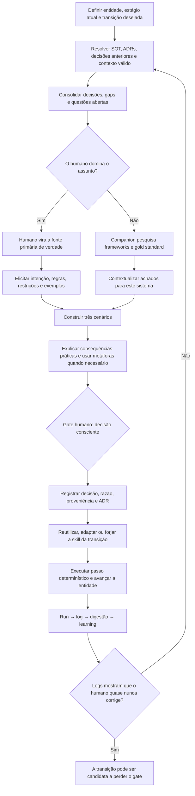

# Sistema de elicitação e controle de Pedro Valério

> **Status: histórico.** Preserva a primeira reconstrução e não governa a
> execução. Para regras atuais, usar `skills/` e `materials/README.md`.

> Reconstrução v0.1 baseada na fala de Pedro no vídeo.
> Fonte primária: [transcrição completa](sources/pedro-transcricao-completa.md).
> Vídeo: [YouTube](https://www.youtube.com/watch?v=ZGm8hpTviPI).
> Escopo: entender e tornar replicável o processo que questiona Pedro, preserva seu controle e converte decisões em skills.

## Resposta curta

O mecanismo descrito por Pedro **não é apenas uma skill de perguntas**. É um ciclo de controle que atravessa o pipeline:

1. identifica a entidade, o estágio atual de seu ciclo de vida e a transição desejada;
2. carrega o contexto já registrado e descobre quais decisões ou lacunas impedem o avanço;
3. pergunta se o humano domina o assunto para definir quem será a fonte de verdade;
4. transforma o problema em três cenários compreensíveis, com consequências práticas;
5. submete a decisão a um gate humano e registra decisão, contexto e proveniência;
6. converte o processo decidido em uma skill que avança a entidade um estágio;
7. aprende com as execuções e só retira o gate humano quando os dados mostram que ele deixou de ser necessário.

A unidade mínima do sistema pode ser resumida assim:

> **entidade + contexto + autoridade epistemológica + cenários + decisão registrada + transição + aprendizado**

## O trecho central

O núcleo aparece entre **02:59:18 e 03:11:38**.

| Momento | O que Pedro afirma | Função no sistema |
|---|---|---|
| [02:59:18](https://www.youtube.com/watch?v=ZGm8hpTviPI&t=10758s) | O processo de elicitação já está no Syncra Pipeline; primeiro se mapeiam uma entidade e um processo. | A elicitação nasce dentro de um processo, não em uma conversa solta. |
| [02:59:37](https://www.youtube.com/watch?v=ZGm8hpTviPI&t=10777s) | Quando chega a um ponto de decisão, o sistema diz que concluiu sua parte e precisa que o humano decida, apresentando três grandes cenários. | O sistema resolve o que puder antes de acionar o humano. |
| [02:59:55](https://www.youtube.com/watch?v=ZGm8hpTviPI&t=10795s) | A primeira pergunta é: “Você domina esse assunto?” | A autoridade da resposta precisa ser definida antes da elicitação. |
| [03:03:16](https://www.youtube.com/watch?v=ZGm8hpTviPI&t=10996s) | Essa pergunta foi a primeira regra colocada no sistema, antes de código, score ou research. | É uma regra fundacional, não um refinamento posterior. |
| [03:03:38](https://www.youtube.com/watch?v=ZGm8hpTviPI&t=11018s) | Se Pedro domina, ele é a maior fonte de verdade; se não domina, o sistema deve pesquisar frameworks e o gold standard do mercado, coerentes com o contexto. | A resposta muda a política de busca e de autoridade. |
| [03:04:07](https://www.youtube.com/watch?v=ZGm8hpTviPI&t=11047s) | A elicitação deve vir em uma forma que ele entenda e mostrar o efeito prático das decisões para o usuário final. | Entendimento real é condição para uma decisão válida. |
| [03:04:33](https://www.youtube.com/watch?v=ZGm8hpTviPI&t=11073s) | Assuntos técnicos devem ser explicados por metáforas ou explicações práticas. | A tradução reduz a assimetria técnica sem retirar o controle humano. |
| [03:10:36](https://www.youtube.com/watch?v=ZGm8hpTviPI&t=11436s) | Depois do mapeamento existe uma forja, um skill creator, que transforma exatamente aquela etapa em skill. | A decisão deixa de ser conversa e vira comportamento reproduzível. |
| [03:11:13](https://www.youtube.com/watch?v=ZGm8hpTviPI&t=11473s) | Cada skill faz uma entidade avançar um passo em seu ciclo de vida. | A skill tem um resultado operacional e observável. |
| [03:11:38](https://www.youtube.com/watch?v=ZGm8hpTviPI&t=11498s) | Sem formalizar os relatórios anteriores, o Codex não encontrou artefatos e precisou analisar tudo novamente. | O conhecimento só persiste quando é materializado. |

Pedro não detalha no vídeo a composição exata dos “três grandes cenários”. Isso precisa continuar marcado como lacuna; qualquer template específico será uma decisão nossa, não uma citação dele.

## O ciclo completo reconstruído



O fluxo possui dois ciclos:

- **ciclo de decisão:** contexto → autoridade → cenários → decisão → artefato;
- **ciclo de confiabilidade:** execução → log → digestão → aprendizado → medição de correções humanas.

O primeiro mantém Pedro no controle agora. O segundo cria evidência para reduzir a dependência dele no futuro.

## As camadas do método

| Camada | Papel | Evidência principal |
|---|---|---|
| Entidade e lifecycle | Define o objeto controlado, onde ele está e qual mudança deve ocorrer. | 03:00:39–03:02:27 |
| Source of truth | Dá ao humano e ao sistema uma versão persistente do estado atual. | 01:31:39–01:32:04 |
| Resolução de contexto | Lê registros relevantes, remove colisões e identifica gaps antes de perguntar. | 03:27:51; 03:32:06–03:32:47 |
| Autoridade epistemológica | Decide se a verdade primária vem de Pedro ou de pesquisa externa contextualizada. | 02:59:55; 03:03:16–03:03:38 |
| Interface de compreensão | Converte conhecimento técnico em consequências, alternativas e metáforas. | 03:04:07–03:05:41 |
| Gate humano | Reserva para a pessoa a decisão que exige intenção, risco ou julgamento. | 02:59:37; 03:32:06 |
| ADR e proveniência | Torna a decisão durável, recuperável e auditável. | 03:11:38; 03:32:06 |
| Skill determinística | Executa a transição já definida entre dois estágios da entidade. | 02:24:12; 02:52:02; 03:10:36–03:11:13 |
| Learning e telemetria | Usa as execuções para qualificar aprendizados e medir a necessidade do gate. | 02:06:50–02:09:09; 04:29:51–04:30:14 |

## Divisão de responsabilidade

Pedro não tenta transformar a IA em um humano superior. Ele separa os espaços de atuação:

| Componente | Deve fazer | Não deve fazer |
|---|---|---|
| Humano | fornecer intenção, regras próprias, apetite a risco e decisões de negócio; ser fonte primária quando domina o tema | responder como especialista quando não possui contexto ou domínio |
| Agente | resolver contexto, encontrar lacunas, pesquisar, construir alternativas e escolher caminhos de execução | fingir certeza ou substituir silenciosamente uma decisão humana relevante |
| Skill | coordenar um passo a passo estável e reproduzível para uma transição da entidade | carregar toda a inteligência do sistema ou improvisar sem limites |
| Código | executar árvores de decisão, scores, validações e operações determinísticas | delegar ao modelo algo que pode ser calculado de forma estável |
| Artefatos | preservar estado, decisões, proveniência, outputs e aprendizados | servir como depósito indiscriminado de todo o contexto disponível |

Essa separação é sustentada por quatro falas:

- em 02:20:46, Pedro diz que usar interpretação do modelo em uma árvore determinística torna variável uma etapa estável;
- em 02:21:30, ele reserva espaços diferentes para humano, IA e código;
- em 02:24:12, define a skill como ponte entre código determinístico e interpretação de linguagem;
- em 03:48:05, diferencia o agente, que decide caminhos, da skill, que permanece determinística em seu passo a passo.

## Protocolo replicável de elicitação

### 1. Enquadrar a transição

Antes de fazer perguntas de conteúdo, o sistema precisa responder:

- qual é a entidade;
- em qual estágio do lifecycle ela está;
- para qual estágio precisa avançar;
- qual decisão impede essa transição;
- quais artefatos representam o estado atual.

Sem isso, a conversa pode produzir uma boa resposta que não move nada no sistema.

### 2. Resolver contexto antes de chamar o humano

O preflight descrito em 03:32:06–03:32:47:

1. resolve os inputs;
2. lê ADRs abertos e o estado atual do projeto;
3. detecta colisões, decisões já tomadas, gaps e questões abertas;
4. delimita o escopo;
5. leva ao gate humano somente o que realmente exige decisão.

Princípio operacional:

> **Não pergunte ao humano o que o sistema pode descobrir nos próprios registros.**

Isso reduz esforço, mas também aumenta a qualidade da pergunta: ela chega com contexto, alternativas e proveniência.

### 3. Definir a fonte de verdade

Pergunta obrigatória:

> **Você domina este assunto o suficiente para ser a fonte primária desta decisão?**

#### Quando a resposta é “sim”

O sistema trata o humano como fonte primária e extrai:

- o resultado desejado;
- as regras que ele já utiliza;
- as restrições não negociáveis;
- sinais de sucesso e de falha;
- exemplos e contraexemplos de decisões anteriores.

O sistema ainda pode confrontar inconsistências ou trazer referências, mas não substitui silenciosamente a regra de negócio do especialista.

#### Quando a resposta é “não”

O sistema muda para research:

- encontra frameworks e referências externas;
- compara o gold standard com o contexto local;
- registra as fontes e os conflitos;
- converte o conteúdo técnico em alternativas compreensíveis;
- retorna para a elicitação, em vez de decidir sozinho.

Em 03:33:33, Pedro nomeia os dois modos: elicitação direta com o humano ou envio de um companion para pesquisar e voltar.

#### Quando a resposta é “parcial”

“Parcial” não é um modo explicitado por Pedro nesse trecho. É uma extensão prática proposta para a v0.1:

- o humano permanece fonte primária apenas nas dimensões que domina;
- o companion pesquisa as dimensões declaradas como desconhecidas;
- conflitos entre experiência local e referência externa voltam ao gate.

### 4. Construir três cenários

Pedro afirma que o sistema sempre apresenta três grandes cenários, mas não revela a estrutura exata. Para uma primeira implementação, cada cenário deve responder ao mínimo necessário:

| Campo | Pergunta respondida |
|---|---|
| Caminho | O que faremos? |
| Consequência | O que muda para o usuário e para o sistema? |
| Trade-off | O que ganhamos e o que sacrificamos? |
| Risco | O que pode dar errado e quão reversível é? |
| Evidência | Em qual regra, artefato ou fonte este cenário se apoia? |

O sistema pode recomendar um cenário, mas deve separar claramente:

- fatos encontrados;
- interpretação do agente;
- regra informada pelo humano;
- recomendação final.

### 5. Traduzir até existir entendimento

Em 03:04:07–03:05:41, Pedro descreve a explicação por “gavetas” que o fez escolher uma arquitetura. A metáfora não é ornamentação; é um dispositivo de controle.

Uma decisão só está pronta para o gate quando o humano consegue:

- explicar com suas palavras o que muda;
- comparar as alternativas sem depender do jargão;
- reconhecer a consequência prática da escolha;
- apontar o risco que está aceitando.

Se isso ainda não for possível, o sistema deve reformular a explicação, não pressionar por uma resposta.

### 6. Registrar a decisão

O output mínimo da elicitação precisa conter:

```yaml
entity:
current_stage:
target_stage:
decision_needed:

knowledge_authority:
  user_mastery: yes | no | partial
  primary_source:

context:
  artifacts_used: []
  artifacts_excluded: []
  gaps: []

scenarios:
  - name:
    consequence:
    tradeoff:
    risk:
    evidence: []

decision:
  selected_scenario:
  rationale:
  constraints: []
  unresolved_questions: []
  decided_by:
  decided_at:

provenance:
  transcript_refs: []
  external_sources: []
  related_adrs: []

transition:
  resulting_skill:
  expected_output:
  next_stage:
```

Esse é um contrato documental mínimo, não um schema definitivo.

### 7. Operacionalizar sem gerar por gerar

Depois da decisão:

1. procurar uma skill ou processo existente que já realize a transição;
2. reutilizar se atender;
3. adaptar se a estrutura servir parcialmente;
4. criar somente o que estiver ausente;
5. registrar o output para a próxima etapa do lifecycle.

Essa ordem vem do ADS descrito em 03:07:20–03:09:56:

> **reuse > adapt > create**

Ela funciona como trava contra a tendência generativa do modelo e mantém o sistema incremental.

### 8. Aprender e retirar gates por evidência

O loop de uma skill é descrito em 02:06:50–02:09:09:

> **run → log → digestão → learning → avaliação/qualificação**

Em 04:29:51–04:30:14, Pedro explica como retirou um gate humano entre validação e desenvolvimento:

1. começou registrando as decisões;
2. observou por dois ou três meses quantas decisões do agente ele alterava;
3. obteve uma amostra real de execuções;
4. removeu o gate apenas quando quase não corrigia mais o agente.

Portanto, autonomia não nasce de confiança subjetiva. Ela é concedida a uma transição específica depois de medir sua estabilidade.

## Blueprint da primeira skill

Nome provisório:

```text
elicitar-decisao-controlada
```

### Gatilho

Uma entidade não pode avançar porque existe uma decisão relevante, um gap ou uma questão aberta.

### Entradas obrigatórias

- entidade e lifecycle;
- estágio atual e estágio desejado;
- decisão bloqueadora;
- artefatos disponíveis;
- pessoa responsável pelo gate.

### Saídas obrigatórias

- classificação do domínio do humano;
- três cenários compreensíveis;
- decisão e justificativa;
- proveniência;
- ADR ou registro equivalente;
- transição e próxima skill.

### Algoritmo mínimo

```text
1. Resolver o contexto atual da entidade.
2. Remover perguntas já respondidas pelos artefatos.
3. Perguntar se o humano domina o assunto.
4. Se domina, elicitar suas regras e intenção.
5. Se não domina, pesquisar e contextualizar referências.
6. Construir três cenários com consequências práticas.
7. Reformular tecnicismos até o humano compreender.
8. Obter e registrar a decisão com proveniência.
9. Reutilizar, adaptar ou criar a skill da transição.
10. Registrar a execução para aprendizado e futura avaliação do gate.
```

### Condições de parada

A skill não pode avançar quando:

- não há entidade ou transição identificável;
- o contexto necessário está ausente e não pode ser recuperado;
- o humano não domina o tema e a pesquisa ainda não voltou;
- o decisor não consegue explicar as consequências;
- a decisão possui conflito não resolvido com uma regra de governança.

### Invariantes

- o sistema não pede ao humano algo já registrado;
- não trata o humano como especialista sem perguntar;
- não apresenta detalhe técnico sem consequência prática;
- não executa uma decisão relevante sem registro;
- não remove um gate sem dados de correção humana;
- não usa o modelo para substituir lógica determinística já conhecida.

## Roteiro de conversa

Este roteiro implementa o blueprint sem exigir uma interface especial.

### Abertura

```text
Estamos decidindo [DECISÃO] para mover [ENTIDADE] de [ESTÁGIO ATUAL]
para [PRÓXIMO ESTÁGIO].

Já consultei [ARTEFATOS] e encontrei [GAPS].

Você domina este assunto o suficiente para ser a fonte primária da decisão?
```

### Se a pessoa domina

```text
1. Qual resultado você quer proteger?
2. Quais regras você já usa para decidir isso?
3. O que não pode acontecer?
4. Dê um exemplo de boa decisão e um de decisão ruim.
5. Em qual situação sua regra deixaria de valer?
```

### Se a pessoa não domina

```text
Vou pesquisar as referências adequadas e voltar com:
- o que é consenso;
- onde as abordagens divergem;
- como cada caminho afeta este projeto;
- três cenários comparáveis;
- fontes e incertezas.
```

### Gate

```text
Cenário A: [caminho, consequência, trade-off, risco e evidência]
Cenário B: [caminho, consequência, trade-off, risco e evidência]
Cenário C: [caminho, consequência, trade-off, risco e evidência]

Minha recomendação é [X] por [RAZÃO].

Qual cenário você escolhe, o que deseja alterar e qual risco aceita?
```

### Confirmação

```text
Vou registrar:
- decisão escolhida;
- razão da escolha;
- restrições e riscos aceitos;
- fontes consultadas;
- impacto na entidade;
- próxima skill e próximo estágio.

Esta formulação representa sua decisão?
```

## Mapa de evidências relacionadas

### 1. Processo antes da conversa

| Momento | Evidência | O que corrobora |
|---|---|---|
| 01:36:12 | Pedro diz que não trabalha apenas conversando com a IA; existe antes uma árvore de processo. | A elicitação depende de uma estrutura anterior. |
| 01:36:26 | A primeira entidade mapeada foi “projeto”; dela surgem skills consistentes. | Entidades são a base de especialização das skills. |
| 01:36:47 | Toda skill ou projeto começa pelo mapeamento do processo. | A skill não deve preceder a compreensão do fluxo. |
| 01:36:55–01:37:35 | No exemplo do app de calorias, mapear o processo permite eliminar o upload manual. | Pensar por transições expõe etapas desnecessárias. |
| 02:56:29 | Uma parte só tem valor quando se entende sua conexão com a próxima e o que ocorre em paralelo. | A elicitação deve produzir um output consumível pela próxima etapa. |

### 2. Fonte de verdade e aprendizado do humano

| Momento | Evidência | O que corrobora |
|---|---|---|
| 01:31:39 | A ferramenta “criar SOT” mapeia um projeto e cria sua source of truth. | Contexto persistente antecede consulta e decisão. |
| 01:32:04 | A SOT permite que Pedro entenda, melhore o projeto e seja ensinado pelo sistema. | O sistema também é uma interface cognitiva para o humano. |
| 01:32:43 | O modo consultivo prioriza conversa em vez de execução. | Elicitar e executar são modos diferentes. |
| 01:33:00 | O modo research traz informação externa e a contextualiza. | Não basta recuperar referência; é preciso relacioná-la ao caso. |
| 04:09:56 | Ao ver consequências de cada caminho em um ADR, Pedro orquestra e aprende ao mesmo tempo. | Uma boa decisão aumenta a capacidade futura do decisor. |

### 3. Contexto com limites

| Momento | Evidência | O que corrobora |
|---|---|---|
| 03:11:38 | Sem relatórios formalizados, o Codex não teve artefatos e refez a análise. | Conversa sem artefato não forma memória operacional. |
| 03:27:51 | Um graph só tem poder depois que as mini-ações e a digestão dos documentos estão definidas. | Não se deve construir uma grande memória antes dos fluxos mínimos. |
| 03:27:51 | Pedro afirma que saber o que não usar como contexto é ainda mais importante. | Elicitação precisa de política explícita de inclusão e exclusão. |
| 03:32:06 | O preflight resolve inputs, ADRs, escopo, colisões, gaps e proveniência. | O humano recebe uma questão já preparada. |
| 03:32:47 | A sessão lê inputs, ADRs abertos e o estado do projeto antes de consolidar questões. | A pergunta é derivada do estado real, não de um prompt genérico. |

### 4. Determinismo e controle

| Momento | Evidência | O que corrobora |
|---|---|---|
| 01:38:00–01:38:36 | IA parece inteligente, mas não possui o risco humano; quality gates apenas simulam limites. | Julgamento humano e barreiras continuam necessários. |
| 02:20:46 | Interpretação do modelo torna variável uma etapa determinística. | Árvores e scores conhecidos devem estar em código. |
| 02:21:30 | Humano, IA e código possuem espaços diferentes. | Controle nasce da divisão explícita de responsabilidade. |
| 02:24:12 | Skill é ponte entre determinismo e interpretação de linguagem. | A skill coordena os dois mundos sem confundi-los. |
| 03:38:38–03:38:59 | Pedro só entrega controle ao sistema depois de controlar e entender o processo; se não entende, pergunta. | Automação vem depois de observabilidade e compreensão. |
| 03:46:30 | Pedro evita responder porque ainda não conhece os épicos e o projeto inteiro. | O sistema não deve forçar decisão de quem não possui contexto. |

### 5. Incremento, digestão e autonomia

| Momento | Evidência | O que corrobora |
|---|---|---|
| 02:06:50–02:09:09 | Cada skill possui loop próprio; os learnings de processo servem globalmente. | Aprendizado nasce localmente e é reutilizado além do projeto. |
| 02:52:02–02:56:03 | Primeiro se estabilizam skills pequenas, depois full cycle, waves e cockpit. | A construção ocorre de baixo para cima. |
| 03:07:20–03:09:56 | ADS impõe reuse > adapt > create e comportamento incremental à IA. | O sistema controla geração desnecessária. |
| 03:49:23–03:51:12 | Heurísticas precisam ser classificadas e enviadas para skills, gates, agentes ou governança. | Extrair conhecimento não basta; é preciso digeri-lo para o destino correto. |
| 04:29:51–04:30:14 | Gate é retirado após meses de logs e baixa taxa de correção humana. | Autonomia é uma conclusão mensurada, não uma premissa. |
| 04:31:51–04:36:39 | Heurísticas externas quebram o conformismo e evitam repetir eternamente decisões locais ruins. | Mesmo uma SOT controlada precisa de confronto externo. |

## Conexões que parecem separadas, mas pertencem ao mesmo sistema

### Metáfora é mecanismo de governança

Se Pedro não entende a decisão, ele não controla o sistema. A metáfora das gavetas transforma uma decisão técnica em uma escolha consciente. Portanto, a tradução é parte do gate, não uma melhoria de comunicação.

### Lifecycle define o limite da skill

“Criar uma skill sobre contratos” é amplo demais. “Mover um contrato de revisão para aprovado” possui entrada, saída e condição de encerramento. A entidade e seu lifecycle transformam conhecimento em operação testável.

### ADR é memória e instrumento de ensino

O ADR não serve apenas para auditoria. Ao mostrar caminhos e consequências, ele ajuda Pedro a aprender enquanto orquestra. Depois, preserva a decisão para que o sistema não precise elicitar o mesmo raciocínio novamente.

### Digestão é roteamento de conhecimento

Em 03:49:23–03:51:12, Pedro diz que extrair heurísticas não basta. Uma heurística de decisão pode alimentar agentes; uma árvore, skills; um score, quality gates; um axioma, governança. “Digerir” significa enviar cada aprendizado para o componente que consegue aplicá-lo.

### Log é a ponte entre controle e autonomia

O gate humano não é permanente nem removido por entusiasmo. O log mede quando o sistema passou a reproduzir a decisão de forma estável. Assim, controle e automação não são opostos: controle observável é o caminho para automação segura.

## O que é evidência, inferência e proposta

| Classificação | Conteúdo |
|---|---|
| Explícito na fala | Perguntar se o humano domina; humano como fonte primária quando domina; research quando não domina; três cenários; consequências práticas; metáforas; entidade/lifecycle; forja de skill; logs antes de retirar gate. |
| Inferência forte | A pergunta de domínio funciona como roteador de autoridade; compreensão é requisito do gate; ADR também é interface de aprendizagem; elicitação e telemetria formam um ciclo único de controle. |
| Proposta v0.1 | Modo “parcial”; campos exatos do YAML; dimensões usadas para comparar os três cenários; perguntas do roteiro; nome `elicitar-decisao-controlada`. |

Essa separação deve ser preservada nas próximas versões para que uma implementação nossa não seja confundida com uma regra original de Pedro.

## Lacunas ainda abertas

1. Qual é o template original dos três cenários e como eles são gerados?
2. Como o sistema determina se alguém realmente “domina” o tema além da autodeclaração?
3. Quais fontes, critérios e conflitos definem o gold standard de cada domínio?
4. Qual é o schema real dos registros de elicitação, SOT, ADR, gaps e proveniência?
5. Qual taxa de correção e qual tamanho de amostra autorizam retirar cada tipo de gate?

## MVP recomendado

Não é necessário recriar o Cockpit inteiro para validar o método. A menor versão útil é:

1. escolher uma entidade real e uma única transição;
2. aplicar o roteiro em três decisões reais;
3. salvar cada decisão no contrato documental mínimo;
4. verificar se outra pessoa ou agente consegue executar a transição sem perguntar tudo novamente;
5. comparar decisões futuras com os registros e contar correções humanas.

Critério de sucesso da primeira versão:

> A elicitação produz uma decisão que Pedro compreende, consegue corrigir e deixa registrada de modo que a próxima execução comece de onde a anterior terminou.
