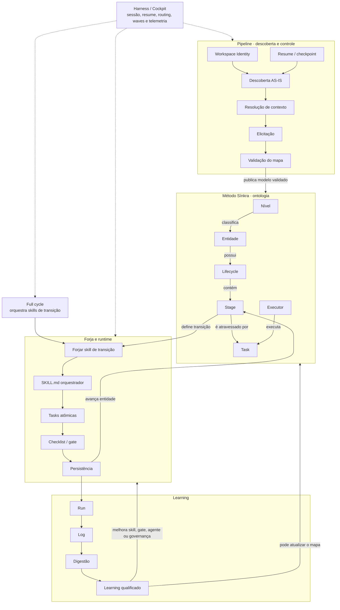
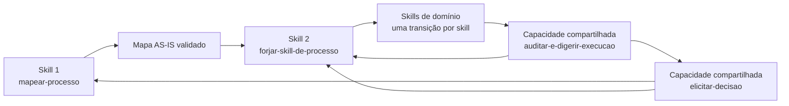

# Avaliação das Aulas 1 e 2 para reconstrução do pack Sínkra

> Diagnóstico v0.1 — ainda não é a especificação final do pack.
> Fontes analisadas: notas das Aulas 1 e 2, [transcrição do vídeo](sources/pedro-transcricao-completa.md) e [análise inicial da elicitação](01-sistema-de-elicitacao-e-controle.md). As notas brutas não integram o pacote portátil porque as 72 imagens citadas não existem no acervo original; esta avaliação preserva a síntese rastreável do conteúdo consumido.

## Veredito

Os dois materiais são decisivos, mas cumprem uma função diferente da transcrição do vídeo:

- **as aulas explicam a ontologia e a arquitetura operacional do Sínkra**;
- **o vídeo explica a mecânica específica de elicitação, controle e autonomia**;
- **a Aula 2 mostra como um processo mapeado é materializado em skills orquestradoras**;
- **nenhuma fonte, isoladamente, especifica todo o pack**.

A reconstrução mais fiel não é uma skill única nem um conjunto arbitrário de prompts. O que emerge é um **meta-pack** capaz de:

```text
descobrir um processo
→ validar sua verdade e suas decisões
→ modelar entidade, lifecycle, stages e tasks
→ forjar uma skill executável para cada transição
→ registrar execuções e aprender
```

O princípio arquitetural mais estável é:

> **entity-first e transition-first, não agent-first.**

O material muda uma conclusão provisória anterior: a elicitação provavelmente **não é o sistema inteiro nem necessariamente uma skill de topo no desenho original de Pedro**. Ela aparece como uma capacidade transversal do pipeline e dos gates. Extraí-la como skill reutilizável pode ser uma boa decisão para o nosso pack, mas deve permanecer marcada como **adaptação arquitetural nossa**.

## Limite das fontes

### Hierarquia de confiança

| Nível | Fonte | Uso permitido |
|---|---|---|
| A | fala direta na transcrição do vídeo | sustentar regras explicitamente verbalizadas |
| B | conteúdo identificado nas notas como `[AULA]`, citação ou slide | sustentar conceitos do curso, respeitando a transcrição feita durante o estudo |
| C | descrição de prints nas notas | sustentar arquitetura observada com ressalva |
| D | marcações `[VOCÊ]`, `[CONEXÃO]` e `[INFERÊNCIA]` | gerar hipóteses e relações a validar |
| E | reconstruções deste diagnóstico ou do crítico simulado | orientar projeto, nunca atribuir ao autor |

Os PNGs citados pelas notas **não estão presentes no repositório**. Portanto, a auditoria visual independente dos prints não foi possível. As descrições preservadas continuam úteis, mas não devem ser elevadas de C para B sem recuperar as imagens originais.

### Natureza dos documentos

As notas não são transcrições lineares puras. Elas misturam:

- fala ou conteúdo de aula;
- observações pessoais;
- descrições de prints;
- conexões analíticas;
- inferências;
- dúvidas e propostas de aplicação.

Essa mistura é bem sinalizada pelas legendas dos próprios arquivos. O pack deve manter a mesma disciplina: **evidência, inferência e decisão de design não podem ocupar o mesmo campo**.

## Engenharia de prompt aplicada à análise

A análise foi dividida em passes para impedir que uma síntese prematura contaminasse a leitura.

| Passagem | Instrução principal | Output |
|---|---|---|
| 1. Extração fiel | atomizar afirmações sem completar lacunas | claims com fonte, localização e classe de evidência |
| 2. Desambiguação | separar termos que parecem sinônimos | tabela de objetos, responsabilidades e fronteiras |
| 3. Cruzamento | procurar suporte, conflito e ausência entre as três fontes | matriz vídeo × aulas |
| 4. Grafo | transformar claims em nós e relações tipadas | grafos de domínio, processo, execução e evidência |
| 5. Crítica | tentar refutar a arquitetura usando apenas os materiais | riscos, falsos encaixes e perguntas abertas |

### Prompt-base de extração

```text
PAPEL
Atue como arquiteto de processos orientado a evidências.

OBJETIVO
Reconstruir o sistema descrito sem confundir fala da fonte,
interpretação do estudante e decisão de implementação.

REGRAS DE FONTE
1. Preserve a localização exata de cada afirmação.
2. Classifique como explícito, observado, interpretação ou proposta.
3. Não resolva contradições por plausibilidade.
4. Ausência de evidência deve virar gap.
5. Termos semelhantes permanecem separados até existir relação comprovada.

PARA CADA CLAIM
- sujeito;
- relação;
- objeto;
- fonte/localização;
- confiança;
- escopo;
- conflito conhecido;
- implicação para o pack.

AUTOVERIFICAÇÃO
- Eu atribuí ao autor algo que veio de uma inferência?
- Transformei exemplo em regra universal?
- Confundi entidade, stage, task, skill, agente ou pipeline?
- O output indica o que ainda não sabemos?
```

### Prompt crítico usado no “Pedro simulado”

O subagente não foi tratado como fonte nem instruído a imitar personalidade. Sua função foi atuar como um **crítico arquitetural inspirado apenas nos padrões observáveis**, com estas restrições:

```text
Não alegue ser Pedro.
Marque toda reconstrução como hipótese.
Leia os artefatos brutos.
Procure interpretações superdimensionadas.
Separe método, pipeline, skill, task, checklist, agente e worker.
Cite linhas ou timestamps.
Não invente intenção do autor.
```

Esse papel serve para produzir conflito e testar a coerência da leitura. Qualquer contribuição dele deve permanecer classificada como **hipótese crítica**.

## Engenharia de grafo

Um único “grafo do Sínkra” seria ambíguo. Os materiais descrevem pelo menos cinco grafos relacionados:

| Grafo | Nós | Relações principais | Pergunta respondida |
|---|---|---|---|
| Ontologia do domínio | entidades, artefatos, níveis | depende, relaciona, herda, gera | O que existe e como se relaciona? |
| Máquina de estados | entidade, stages, transições | nasce, avança, retorna, morre | Onde a entidade está? |
| Execução | tasks, executores, gates, outputs | depende, paraleliza, bloqueia, consome, produz | O que precisa acontecer agora? |
| Evidência e decisão | claims, fontes, gaps, cenários, ADRs | sustenta, contradiz, deriva, decide | Por que acreditamos ou escolhemos isso? |
| Aprendizado | runs, logs, learnings, regras | observa, digere, qualifica, atualiza | O que deve mudar após as execuções? |

Misturar esses grafos causaria erros como tratar um status de task como stage da entidade, uma relação de contexto como dependência de execução ou uma inferência como fato do domínio.

### Grafo integrado, mantendo as fronteiras



O Cockpit/harness é o ambiente que sustenta a execução durável. Ele não é a metodologia nem uma skill específica.

## O que a Aula 1 acrescenta

Referências centrais: fórmula-mestra em A1:L12, skill em A1:L730, fórmula da skill em A1:L754, No-Invention em A1:L789, cadeia de outputs em A1:L839, auto-gate em A1:L899 e Journey Log em A1:L1112.

| Ponto | Avaliação | Uso no pack |
|---|---|---|
| Entidade → lifecycle → stage → task | Fundação explícita e consistente. | Deve viver como referência canônica compartilhada, não ser repetida integralmente em toda skill. |
| Tasks movem entidades | Define a unidade operacional da skill. | Toda skill forjada deve declarar entidade, stage de origem e stage de destino. |
| Task atômica | Contrato com verbo, executor, entrada e saída; depois aparecem reviewer, accountable e AC. | Deve orientar os arquivos de task e impedir prompts amplos disfarçados de task. |
| Humano, Worker e Agente | Roteamento por natureza do trabalho. | Worker para determinismo; Agente para interpretação contextual; Humano para responsabilidade, risco e exceção. |
| Design por restrições | Caminhos errados devem ser impossibilitados ou bloqueados. | Gates, schemas e código são preferíveis a lembretes em linguagem natural. |
| Fórmula da skill | `contexto + tasks atômicas + gate + persistência + transição`. | É o contrato arquitetural mais direto para as skills produzidas. |
| No-Invention | Ausência vira “Informação faltante” e pergunta. | É precursor direto do mecanismo de elicitação. |
| Output vira input | A entidade persistida conecta tasks e permite fan-out/join. | Toda task precisa declarar destino e consumidor seguinte. |
| Journey Log | Registra evento, autor, alteração e efeito. | Sustenta auditoria, resume, comparação de decisões e learning. |
| Herança e Spawn | Contexto desce e entidades filhas nascem a partir do tático. | Pertencem ao método de modelagem; não devem ser acoplados à skill de elicitação. |

### A arquitetura de skill mostrada

```text
projeto--S02-estruturar-briefing/
├─ checklists/
│  └─ gate-estruturar-briefing.md
└─ tasks/
   ├─ avaliar_briefing.md
   └─ normalizar_briefing.md
```

Leitura correta:

| Peça | Responsabilidade |
|---|---|
| Skill | orquestrar o recorte de processo que produz uma transição |
| Task | executar uma transformação atômica |
| Checklist/gate | provar que a transição pode ocorrer |
| Entidade | fornecer contexto e receber o estado/output |
| Journey Log | registrar como a transformação ocorreu |

O checklist não substitui a task. A task produz ou transforma; o checklist verifica. O workflow também não é um arquivo adicional obrigatório: ele é o **grafo de ordem, condição, paralelismo e handoff coordenado pela skill**.

### O que não deve ser copiado literalmente

- O lifecycle de Projeto da AllFluence é exemplo de domínio, não padrão universal.
- Os campos do ClickUp não formam um schema genérico para qualquer operação.
- `tasks/` e `checklists/` representam a arquitetura de Pedro; no formato Codex, esses arquivos precisarão ser referenciados explicitamente pelo `SKILL.md`.
- Um auto-gate observado não prova a política universal de passagem.
- A fórmula “89% fora das mãos” mede contagem de tasks naquele case, não risco, valor ou autonomia geral.

## O que a Aula 2 acrescenta

Referências centrais: Pipeline/Chief em A2:L385, estado persistido em A2:L440, ambiguidade em A2:L490, skill orquestradora em A2:L554, Benchmark componível em A2:L686, duas topologias em A2:L802, agentes como executores em A2:L827 e narrative-first em A2:L1033–1149.

| Ponto | Avaliação | Uso no pack |
|---|---|---|
| Estratégico, Tático e Operacional | Classificam residência e horizonte das entidades. | Referência de modelagem; não são stages nem pastas do pack. |
| Herança | Política de propagação de contexto. | Deve ser explicitada campo por campo; referência viva, snapshot, padrão ou local não são equivalentes. |
| Spawn | Criação de entidades operacionais a partir de uma definição tática. | Requer gate, quantidade, idempotência, rollback e contexto herdado. |
| Biblioteca de entidades | Separa modelo, instância e despacho. | Sugere que o pack produz modelos reutilizáveis, mas execução permanece controlada. |
| Pipeline + Agente-Chefe | Resolve workspace, resume, regras, validação e delegação. | É infraestrutura de orquestração; não deve ser confundida com a skill de domínio. |
| Estado como artefato | Progresso não depende da memória do chat. | Checkpoints e handoffs precisam ser outputs persistentes. |
| Ambiguidade explícita | Diante de múltiplos rumos, o sistema apresenta opções e pergunta. | Corrobora o gate decisório do vídeo. |
| Narrative-first | Primeiro AS-IS real, depois TO-BE. | É o modo central da skill de descoberta de processo. |
| Quatro modos de descoberta | material, narrativa, híbrido ou investigação. | Parametrizam como o contexto é coletado antes da validação humana. |
| Skill orquestradora | `SKILL.md` coordena tasks e checklists de um stage. | É o blueprint direto para a implementação no pack. |
| Benchmark componível | Um catálogo de tasks pode gerar rotas diferentes por contexto. | Prova que skill não precisa ser uma sequência fixa, desde que o roteamento seja explícito. |
| Agente não é processo | Agente é executor dentro de contrato operacional. | Impede que o pack vire uma coleção de personas ou squads soltos. |

### As duas topologias de skill

| Topologia | Exemplo | Estrutura | Quando usar |
|---|---|---|---|
| Sequência estável | `S01-descobrir-processo` | oito tasks ordenadas até um gate | quando a passagem exige sempre a mesma cadeia |
| Rota componível | `benchmark` | catálogo de 19 tasks selecionadas por contexto | quando capacidade necessária varia por briefing, plataforma ou domínio |

Em ambas:

- as tasks continuam atômicas;
- o contexto seleciona ou parametriza a execução;
- tasks não escolhidas precisam ser marcadas como não aplicáveis;
- um gate governa a transição;
- o output retorna à entidade ou ao chamador.

### O Pipeline Skill não é a mesma coisa que a skill de transição

```text
PIPELINE / CHIEF
decide onde trabalhar, se deve retomar, qual branch e qual especialista

SKILL DE TRANSIÇÃO
executa um recorte de processo dentro de uma entidade e stage definidos

AGENTE DE DOMÍNIO
é um dos executores possíveis das tasks
```

O Pipeline responde **onde, quando e por qual caminho continuar**. A skill de transição responde **como produzir uma mudança delimitada**. O agente executa parte desse trabalho.

### “Skill orquestradora” aparece em duas escalas

| Escala | O que coordena | Evidência |
|---|---|---|
| Orquestração interna | tasks necessárias para uma transição de stage | `SKILL.md` de S01/S02 nas aulas |
| Orquestração de ciclo | várias skills de transição já estabilizadas | validate → develop → close → full cycle no vídeo |

As duas podem usar o mesmo mecanismo de composição, mas não devem receber o mesmo nome interno sem qualificador. Uma possibilidade futura é reservar `skill de transição` para a primeira e `full-cycle orchestrator` para a segunda.

## Cruzamento com a elicitação do vídeo

### Frequência dos conceitos

A contagem literal não prova significado, mas mostra onde cada assunto é desenvolvido:

| Termo | Aula 1 | Aula 2 | Vídeo |
|---|---:|---:|---:|
| entidade | 205 | 139 | 15 |
| task | 322 | 143 | 3 |
| skill | 28 | 44 | 40 |
| gate | 44 | 28 | 14 |
| elicitação | 0 | 0 | 6 |
| research | 1 | 0 | 4 |
| cenário | 0 | 0 | 5 |
| herança | 20 | 26 | 0 |
| spawn | 36 | 31 | 3 |

Conclusão: **as aulas são a fundação do método e da arquitetura de skills; o vídeo é a fonte primária da capacidade específica de elicitação**.

### Matriz de encaixe

| Elemento do vídeo | Apoio das aulas | Resultado |
|---|---|---|
| Mapear entidade e processo primeiro | fórmula da Aula 1 e S01 da Aula 2 | encaixe direto |
| Resolver contexto antes de agir | SOT, outputs persistidos, Workspace Identity e Resume | encaixe direto |
| Perguntar se o humano domina | não aparece nas aulas | regra exclusiva do vídeo |
| Humano como fonte primária quando domina | Humano decide/responde pelo risco | apoio parcial; a política de autoridade vem do vídeo |
| Pesquisar quando não domina | modo research do vídeo; quatro modos de descoberta na Aula 2 | relacionados, mas não equivalentes |
| Apresentar três cenários | não aparece nas aulas | especificação exclusiva do vídeo |
| Traduzir por consequências e metáforas | não aparece como regra das aulas | especificação exclusiva do vídeo |
| Declarar informação faltante | No-Invention e ponte gap → pergunta da Aula 1 | encaixe direto |
| Gate humano | presente nas duas aulas | encaixe direto |
| Registrar ADR/proveniência | Journey Log, SOT e handoffs dão base; ADR vem do vídeo | encaixe complementar |
| Forjar skill após mapear | arquitetura das skills nas aulas; skill creator no vídeo | encaixe direto |
| Retirar gate após medir correções | Journey Log dá infraestrutura; critério temporal vem do vídeo | encaixe complementar |

## Duas elicitações diferentes

Os materiais revelam dois processos relacionados, mas não idênticos.

### Elicitação de descoberta

Objetivo: reconstruir a verdade operacional AS-IS.

```text
material/narrativa/investigação
→ extrair entidades, estados, tasks e relações
→ preservar gaps e conflitos
→ validar status por status
→ publicar mapa AS-IS
```

Pergunta principal:

> **O que realmente acontece hoje?**

### Elicitação de decisão

Objetivo: resolver um ponto em que o sistema não pode avançar sozinho.

```text
contexto e gaps resolvidos
→ verificar domínio do humano
→ fonte humana ou research
→ três cenários compreensíveis
→ decisão
→ ADR/proveniência
```

Pergunta principal:

> **Quem possui autoridade para decidir e quais consequências cada caminho produz?**

Elas podem compartilhar componentes, mas não devem ser fundidas em um único prompt:

| Descoberta | Decisão |
|---|---|
| captura AS-IS | escolhe caminho futuro |
| busca descrição e evidência | busca julgamento e consequência |
| valida estados e exceções | compara cenários |
| output é mapa candidato/validado | output é decisão registrada |
| ocorre durante mapeamento | ocorre em qualquer gate relevante |

## Fronteiras que o pack precisa preservar

| Objeto | É | Não é |
|---|---|---|
| Método Sínkra | ontologia e princípios de modelagem/operação | uma skill executável |
| Pipeline | sistema que resolve contexto, progresso, branch e direção | a task de domínio |
| Pipeline de execução | sequência ou DAG de etapas/skills já mapeadas | pipeline de descoberta |
| Skill orquestradora | processo executável de uma transição | agente ou prompt único |
| Full cycle | composição de várias skills de transição estáveis | uma task atômica |
| Workflow | grafo de dependências, condições, fan-out, join e handoffs | necessariamente um arquivo autônomo |
| Task | transformação atômica contratada | checklist ou entidade-alvo |
| Checklist/gate | prova de passagem | trabalho que produz o output |
| Agente | executor e decisor contextual dentro de limites | processo completo |
| Worker | execução determinística | inteligência contextual |
| Entidade | objeto com identidade e lifecycle | task da ferramenta |
| Artefato | output persistido e consumível | memória implícita da conversa |
| Harness/Cockpit | runtime de sessões, resume, routing, handoffs, waves e telemetria | método ou skill de domínio |

## Arquitetura candidata do pack

Isto é uma hipótese de organização para discussão, não uma decisão final:



### Componentes candidatos

| Componente | Status de evidência | Responsabilidade |
|---|---|---|
| `mapear-processo` | forte | narrative-first, quatro modos, modelagem e validação AS-IS |
| `elicitar-decisao` | conteúdo forte; separação como skill é nossa | autoridade, research, cenários, compreensão e gate |
| `forjar-skill-de-processo` | forte | converter uma transição validada em skill, tasks e checklist |
| `auditar-e-digerir-execucao` | médio | transformar run/log em learning e rotear melhoria |
| skills de domínio | forte | mover entidades entre stages reais |

### O que deve ser referência, não skill

- taxonomia Entidade/Lifecycle/Stage/Task;
- Estratégico/Tático/Operacional;
- políticas de Herança e Spawn;
- tipos de executor;
- schemas conceituais de task, gate, evento, handoff e decisão.

Esses elementos dão linguagem e regras às skills. Não representam, sozinhos, uma ação invocável.

## Adaptação ao formato Codex

O desenho de Pedro usa `SKILL.md`, `tasks/` e `checklists/`. No Codex, o `SKILL.md` precisa permanecer conciso e carregar detalhes progressivamente.

Uma adaptação provável:

```text
mapear-processo/
├─ SKILL.md
└─ references/
   ├─ metodo-sinkra.md
   ├─ tasks/
   └─ checklists/
```

Isso preserva a separação conceitual sem depender de o runtime descobrir automaticamente pastas arbitrárias. Scripts só devem existir quando houver validação ou transformação determinística que realmente precise ser repetida.

O pack pode ser distribuído futuramente como plugin. Essa embalagem não deve ser criada antes de:

- termos fronteiras estáveis entre as skills;
- possuirmos ao menos um processo real mapeado;
- forjarmos uma skill de domínio;
- executarmos e avaliarmos essa skill;
- validarmos o comportamento em uma sessão nova.

## Riscos de interpretação

### 1. Transformar todo o Método Sínkra em uma skill

O método é a ontologia de fundo. Carregá-lo inteiro em toda execução aumentaria contexto e misturaria modelagem com operação.

### 2. Chamar cada arquivo de task de skill

Nos exemplos, a skill orquestra várias tasks. A task é a unidade atômica; a skill é o processo executável da transição.

### 3. Tratar o Agente-Chefe como processo

O Chief resolve intenção, contexto e delegação. O estado do processo pertence à entidade, ao pipeline e aos artefatos persistidos.

### 4. Fundir descoberta e decisão

Narrative-first documenta o que acontece. Os três cenários ajudam a escolher o que fazer. Misturar os dois faria a descoberta AS-IS contaminar-se com propostas TO-BE.

### 5. Simular Pedro como autoridade

Um “Pedro simulado” pode detectar incoerências e produzir perguntas. Ele não pode resolver gaps factuais nem criar regras atribuídas ao autor.

### Resultado útil do crítico simulado

O crítico acrescentou quatro hipóteses que resistem ao cruzamento das fontes:

- o átomo arquitetural é a transição de uma entidade, não o agente;
- “skill orquestradora” está sendo usado em duas escalas;
- Cockpit/harness é runtime externo às skills;
- elicitação ocorre tanto no mapeamento quanto em gates durante a execução.

Também sinalizou duas simplificações perigosas:

- **determinístico não significa output idêntico:** na fala de Pedro, a estrutura de passos e as chamadas de código permanecem controladas, mas uma LLM continua podendo produzir variação;
- **checklist, acceptance criteria e gate ainda não possuem equivalência formal comprovada:** sabemos que verificam e governam passagem, mas não se são três objetos distintos ou representações do mesmo controle.

## Decisões que ainda não devem ser tomadas

1. Se `elicitar-decisao` será skill pública, subskill interna ou protocolo compartilhado.
2. Como nomear e separar a orquestração interna de tasks da orquestração full cycle.
3. Qual é o template real dos três cenários.
4. Qual schema de grafo e persistência será adotado.
5. Qual processo real será o primeiro teste de ponta a ponta.

## Critério para a próxima fase

Antes de criar o plugin ou scaffoldar todas as skills, precisamos conseguir responder com um caso concreto:

```text
fonte bruta
→ mapa AS-IS com proveniência
→ gaps e decisões elicitados
→ uma transição validada
→ uma skill forjada
→ uma execução registrada
```

Se essa cadeia funcionar em uma entidade real, teremos evidência para definir o pack. Sem ela, qualquer arquitetura final ainda seria principalmente especulação.
