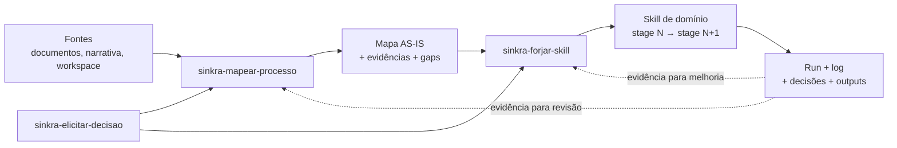

# Especificação v1 do pack Sínkra

> **Status: substituída.** Esta proposta registra a evolução do pack, mas nomes,
> cardinalidade de opções, referências e estrutura não governam a versão atual.
> Usar `skills/`, `skills/_shared/` e `materials/README.md`.
> Base: [elicitação e controle](01-sistema-de-elicitacao-e-controle.md) e [avaliação cruzada das aulas](02-avaliacao-e-arquitetura-do-pack.md).

## Objetivo

Transformar conhecimento operacional disperso em:

```text
processo AS-IS validado
→ decisões registradas
→ skills executáveis por transição
```

O pack é entity-first e transition-first. Agentes, Workers e Humanos são executores das tasks; não são o ponto de partida da arquitetura.

## Escopo da v1

| Skill | Responsabilidade | Output principal |
|---|---|---|
| `sinkra-mapear-processo` | descobrir e validar como um processo realmente funciona | mapa AS-IS com entidades, lifecycles, stages, tasks, relações, evidências e gaps |
| `sinkra-elicitar-decisao` | resolver um ponto de decisão sem fingir domínio ou certeza | três cenários compreensíveis + decisão + proveniência |
| `sinkra-forjar-skill` | converter uma transição validada em skill Codex | skill orquestradora com tasks, gate, persistência e observabilidade |

Não entra na v1:

- Cockpit/harness;
- execução full cycle;
- Herança e Spawn como automações;
- engine própria de grafo;
- skill autônoma de learning/digestão.

Esses componentes dependem de execuções reais e contratos ainda não validados.

## Grafo do pack



`sinkra-elicitar-decisao` é pública porque também pode ser chamada fora do mapeamento e da forja. Internamente, as outras duas skills podem invocá-la quando encontrarem um gate de decisão.

## Skill 1 — `sinkra-mapear-processo`

### Gatilhos

Usar quando a pessoa pedir para:

- mapear, documentar ou entender um processo;
- reconstruir uma operação a partir de materiais;
- transformar narrativa em entidades, stages e tasks;
- descobrir gaps, conflitos ou dependências;
- separar AS-IS de TO-BE.

### Modos de entrada

| Modo | Fonte | Uso |
|---|---|---|
| material | documentos, telas, logs e skills existentes | quando há evidência recuperável |
| narrativa | relato de um caso real | quando o processo está na cabeça das pessoas |
| híbrido | material + narrativa | quando fontes possuem gaps ou divergências |
| investigação | workspace e sistemas conectados | quando ninguém sabe onde está a verdade |

### Workflow

```text
1. Detectar estado e artefatos existentes.
2. Definir entidade/processo e limites.
3. Capturar narrativa e evidências AS-IS.
4. Extrair entidades, lifecycles, stages, tasks e relações candidatas.
5. Separar fato, interpretação, conflito e gap.
6. Validar status por status com a fonte adequada.
7. Registrar exceções, loops, esperas, falhas e retornos.
8. Publicar o mapa AS-IS versionado.
9. Guardar sugestões TO-BE separadamente.
```

### Invariantes

- narrar o que acontece, não o que deveria acontecer;
- não transformar documento oficial em verdade praticada sem validação;
- não criar entidade sem identidade e lifecycle;
- não criar task sem verbo, executor, input e output;
- não apagar conflito entre fontes;
- não misturar stage da entidade com status da task;
- não publicar mapa sem proveniência e responsável pela validação.

### Contrato de saída

```yaml
process:
  name:
  scope:
  as_is_version:
  validated_by:
  validated_at:

entities:
  - name:
    level:
    identity:
    birth:
    death:
    lifecycle: []

transitions:
  - entity:
    from_stage:
    to_stage:
    tasks: []
    gate:

tasks:
  - verb:
    executor_type:
    input:
    output:
    acceptance_criteria: []

relations: []
exceptions: []
gaps: []
conflicts: []
evidence: []
to_be_candidates: []
```

## Skill 2 — `sinkra-elicitar-decisao`

### Gatilhos

Usar quando:

- uma entidade ou execução estiver bloqueada por decisão;
- houver mais de um caminho válido;
- o sistema não souber se o humano possui domínio;
- fontes entrarem em conflito;
- uma escolha técnica precisar ser traduzida em consequências práticas.

### Workflow

```text
1. Resolver entidade, stage, decisão e contexto existente.
2. Remover perguntas já respondidas pelos artefatos.
3. Perguntar se o decisor domina o assunto.
4. Se domina, tratá-lo como fonte primária e elicitar suas regras.
5. Se não domina, pesquisar referências e contextualizá-las.
6. Construir exatamente três cenários comparáveis.
7. Traduzir tecnicismos em consequências e metáforas.
8. Confirmar compreensão antes de pedir escolha.
9. Registrar decisão, razão, risco, incerteza e proveniência.
10. Devolver a decisão para o processo chamador.
```

### Contrato dos cenários

Cada cenário deve conter:

```yaml
name:
path:
practical_consequence:
user_impact:
tradeoffs:
risks:
reversibility:
evidence:
agent_interpretation:
```

O template exato dos três cenários de Pedro não foi encontrado. Este contrato é uma implementação nossa e precisa ser validado em uso.

### Condições de bloqueio

- entidade ou decisão não identificada;
- contexto obrigatório não recuperado;
- pesquisa necessária ainda não concluída;
- decisor não compreendeu as consequências;
- conflito com regra de governança não resolvido.

## Skill 3 — `sinkra-forjar-skill`

### Gatilhos

Usar quando:

- uma transição de processo estiver validada;
- o usuário pedir para converter processo em skill;
- tasks existentes precisarem ser organizadas em uma skill orquestradora;
- uma skill precisar ser adaptada a uma nova entidade ou transição.

### Workflow

```text
1. Confirmar entidade, stage de origem e stage de destino.
2. Verificar se o mapa AS-IS e a decisão estão validados.
3. Aplicar reuse > adapt > create.
4. Calibrar atomicidade das tasks.
5. Classificar executor: Humano, Worker ou Agente.
6. Definir ordem, condições, paralelismo e handoffs.
7. Separar task, acceptance criteria, checklist e gate.
8. Definir persistência, próximo consumidor e Journey Log.
9. Gerar SKILL.md conciso e referências necessárias.
10. Validar e forward-testar com um caso sem contexto vazado.
```

### Contrato da skill forjada

```yaml
skill:
  name:
  entity:
  from_stage:
  to_stage:
  trigger:
  inputs: []
  outputs: []
  tasks: []
  dependencies: []
  routing_rules: []
  gate:
  persistence:
  journey_log:
  failure_modes: []
  resume:
```

### Regras

- uma skill move uma entidade por uma transição delimitada;
- uma skill pode conter várias tasks;
- uma task pode chamar Agente, Worker ou Humano;
- determinismo se refere à estrutura e às regras, não a output textual idêntico;
- lógica calculável deve ir para código;
- task não aplicável precisa ser registrada, não omitida silenciosamente;
- um full cycle só deve compor skills de transição já validadas.

## Referências compartilhadas

| Referência | Conteúdo |
|---|---|
| `sinkra-core.md` | Entidade, Lifecycle, Stage, Task, níveis e executores |
| `evidence-model.md` | fonte, claim, confiança, conflito, gap e proveniência |
| `task-contract.md` | atomicidade, input/output, executor, AC e estados |
| `decision-contract.md` | domínio, research, cenários, decisão e ADR |
| `gate-contract.md` | checklist, blockers, warnings e autorização de transição |

As referências serão carregadas somente quando a etapa exigir. O conteúdo completo das aulas permanecerá em `materiais/`, não dentro da janela de cada skill.

## Organização proposta

```text
synkra-skills/
├─ materiais/
├─ references/
│  ├─ sinkra-core.md
│  ├─ evidence-model.md
│  ├─ task-contract.md
│  ├─ decision-contract.md
│  └─ gate-contract.md
└─ skills/
   ├─ sinkra-mapear-processo/
   │  ├─ SKILL.md
   │  ├─ agents/openai.yaml
   │  └─ references/output-contract.md
   ├─ sinkra-elicitar-decisao/
   │  ├─ SKILL.md
   │  ├─ agents/openai.yaml
   │  └─ references/scenario-template.md
   └─ sinkra-forjar-skill/
      ├─ SKILL.md
      ├─ agents/openai.yaml
      └─ references/forge-contract.md
```

As skills referenciam a fundação compartilhada por caminho relativo. Isso torna o pack uma unidade de distribuição; instalar uma skill isoladamente exigirá copiar suas referências.

## Exemplos de uso

### Descoberta

```text
Use sinkra-mapear-processo para reconstruir como fazemos casting hoje.
Leia estes documentos, preserve conflitos e entreviste-me sobre os gaps.
Não proponha melhorias antes de eu validar o AS-IS.
```

### Decisão

```text
Use sinkra-elicitar-decisao para decidir como armazenar os estados.
Eu não domino a parte técnica; pesquise e explique três caminhos
pelas consequências práticas.
```

### Forja

```text
Use sinkra-forjar-skill para transformar a transição
Briefing → Onboarding já validada em uma skill Codex.
```

## Critério de aceite da v1

A v1 estará pronta quando, em uma sessão nova:

1. `sinkra-mapear-processo` produzir um mapa AS-IS rastreável;
2. `sinkra-elicitar-decisao` resolver um gap sem inventar domínio;
3. `sinkra-forjar-skill` produzir uma skill de transição válida;
4. a skill produzida conseguir executar um caso real;
5. o output permanecer utilizável pela próxima execução.
