# NORTE — Mapa Operacional Detalhado

> **Versão:** `0.1`
> **Escopo:** Central · Receita · Produto & Cliente · Produção
> **Leitura:** processo → lifecycle → stage → task → gate → artefato
> **Fontes:** Full Sales AS-IS · ADR 0009/0010 · Método Sínkra

---

## 0. Como ler este mapa

| Sinal | Classe | Uso |
|---|---|---|
| 🟢 | **Observado** | Reconstruído do Full Sales AS-IS |
| 🔵 | **Ratificado** | Contrato aprovado para o piloto |
| 🟠 | **Candidato** | TO-BE ainda sujeito ao gate do owner |
| 🔴 | **Exceção** | Falha, recusa, cancelamento ou retorno |
| ◇ | **Gate** | Decide se a transição pode ocorrer |
| ▣ | **Artefato** | Output persistido entregue ao próximo consumidor |

> [!IMPORTANT]
> **Tasks, dentro de stages, movem entidades pelo lifecycle.**
> Checklist verifica. Acceptance criterion prova. Gate autoriza ou bloqueia.

### Gramática mínima

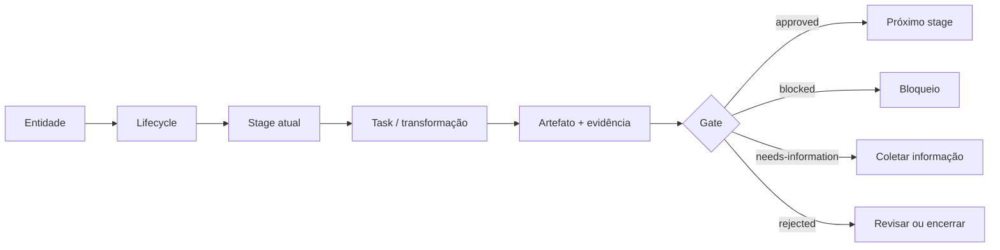

---

# 1. Arquitetura geral

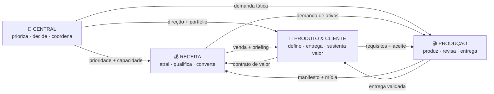

## 1.1 Handoffs entre boards

| Origem | Disparo | Handoff mínimo | Destino | Gate |
|---|---|---|---|---|
| Central | iniciativa priorizada | objetivo, owner, restrições, sucesso | qualquer board | capacidade confirmada |
| Receita | venda confirmada | cliente, oferta, promessa, contexto | Produto & Cliente | contrato + pagamento |
| Receita | ativo necessário | briefing, formato, prazo, destino | Produção | demanda delimitada |
| Produto & Cliente | demanda aprovada | requisitos, critérios, referências | Produção | aceite definido |
| Produção | remessa pronta | manifesto, versões, links, evidências | solicitante | 100% requeridos aprovados |
| Qualquer board | bloqueio estrutural | contexto, impacto, opções | Central | decisão necessária |

## 1.2 Full cycle — da demanda ao valor

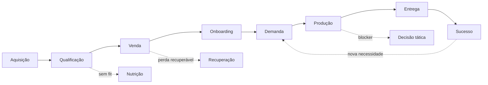

| Etapa | Entidade predominante | Worker principal | Evidência de saída |
|---|---|---|---|
| Aquisição | Lead | captura + atribuição | cadastro identificado |
| Qualificação | Lead | dedupe + scoring | lead qualificado |
| Venda | Oportunidade / reunião | validações comerciais | contrato / motivo de perda |
| Onboarding | Cliente | provisionamento | contexto confirmado |
| Demanda | Demanda | classificação + roteamento | escopo aceito |
| Produção | Remessa + conteúdo | validações técnicas | versões aprovadas |
| Entrega | Remessa | manifesto + despacho | comprovante de entrega |
| Sucesso | Cliente | alertas + métricas | marco de valor |

---

# 2. Central — direção e coordenação

## 2.1 Decisão 🟠

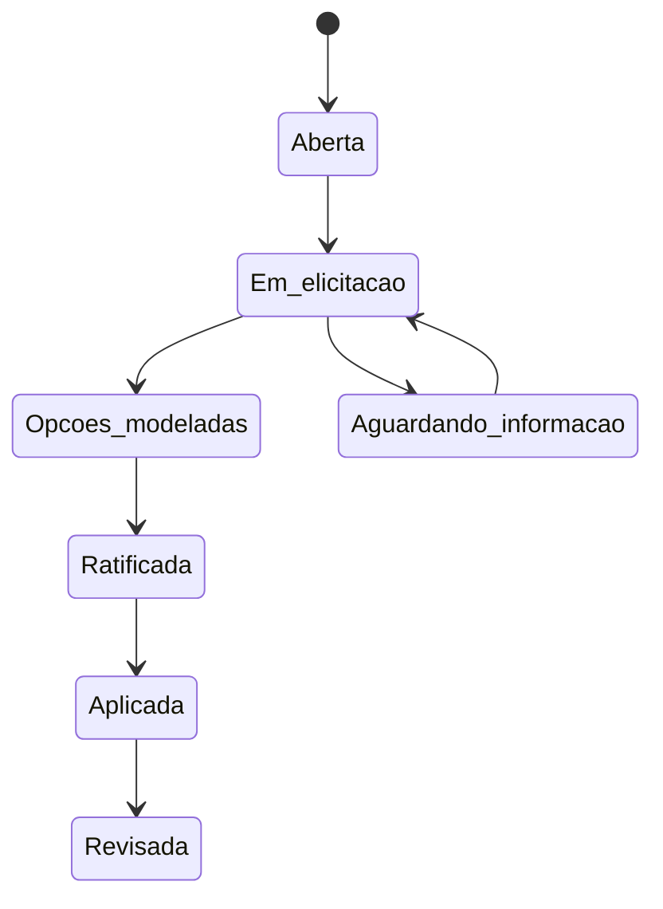

| Disparo | Tasks-chave | Gate | Artefato | Exceções |
|---|---|---|---|---|
| tensão, conflito ou escolha | explicitar tensão · coletar critérios · modelar opções · avaliar consequências | owner escolhe uma opção explicitamente | `decision-record` | informação insuficiente · premissa alterada |

**Exemplo:** escolher se uma nova mídia será um novo `VIDEO` ou apenas uma nova `VERSAO`.

## 2.2 Iniciativa 🟠

`CAPTURADA → EM ANÁLISE → PRIORIZADA → EM EXECUÇÃO → EM REVISÃO → ENCERRADA`

| Campo | Definição operacional |
|---|---|
| **Nasce quando** | uma oportunidade é registrada com resultado desejado |
| **Move quando** | impacto, esforço, dependências e capacidade ficam claros |
| **Gate de entrada** | alinhamento estratégico + owner + critério de sucesso |
| **Gate de saída** | resultado medido + aprendizado consolidado |
| **Pode gerar** | projetos, demandas, decisões e ações pontuais |
| **Não é** | um agrupador infinito de tarefas |

## 2.3 Projeto transversal 🟠

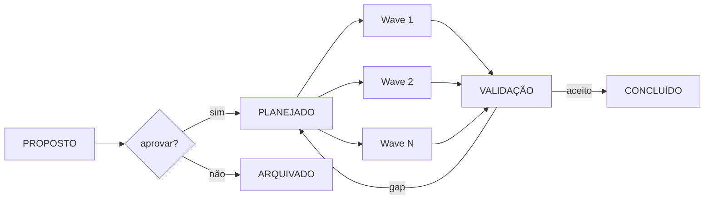

> [!TIP]
> Uma **wave** contém tudo que pode acontecer em paralelo. O que depende do output da wave atual fica na próxima.

---

# 3. Receita — aquisição, venda e continuidade

## 3.1 Blueprint geral do Full Sales 🟢

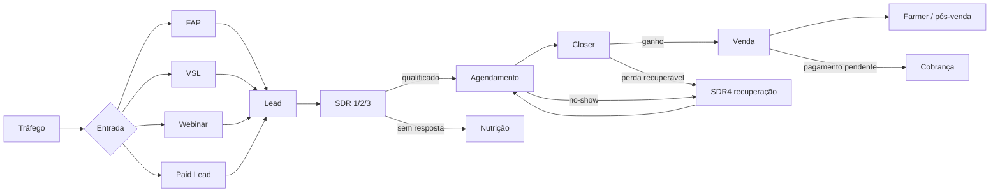

### Regras observadas

| Regra | Parâmetro | Função |
|---|---:|---|
| Speed to Lead | `< 10 min` | reduzir perda por demora |
| Cadência | `10 contatos / 3 dias` | explorar múltiplas tentativas |
| Deduplicação | `1 identidade por lead` | preservar histórico |
| Reentrada | histórico recuperado | evitar começar do zero |

## 3.2 Aquisição e captura 🟢

`TRÁFEGO → PÁGINA → CADASTRO → DEDUPE → ATRIBUIÇÃO → FILA SDR`

| Transição | Task | Automação possível | Acceptance criteria |
|---|---|---|---|
| tráfego → página | identificar campanha | UTMs / click IDs | origem legível |
| página → cadastro | capturar dados | validação de formulário | contato minimamente válido |
| cadastro → dedupe | comparar identidade | e-mail / telefone normalizado | não criar duplicata silenciosa |
| dedupe → atribuição | registrar fonte | regra determinística | origem + campanha persistidas |
| atribuição → fila | rotear responsável | distribuição de leads | owner e timestamp definidos |

🔴 **Desvios:** contato inválido · duplicata · ausência de consentimento · origem desconhecida.

## 3.3 SDR — qualificação 🟢

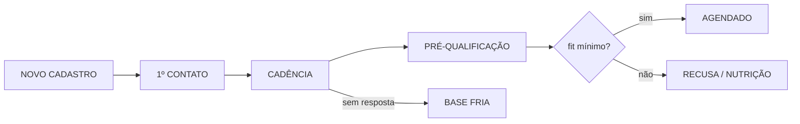

| Task | Executor recomendado | Output |
|---|---|---|
| priorizar novo lead | Worker | posição na fila |
| contextualizar contato | Agente | resumo de origem e hipótese |
| realizar contato | Humano | tentativa + resultado |
| aplicar qualificação | Humano + Agente | critérios respondidos |
| agendar | Worker | reunião + confirmação |

**Gate para `AGENDADO`:** perfil mínimo + problema/contexto + disponibilidade + expectativa registrada.

<details>
<summary><b>Exemplo de handoff SDR → Closer</b></summary>

```yaml
lead: LEAD-IBR-0142
origem: VSL-YTD
problema_declarado: previsibilidade de aquisição
momento: decisão em até 30 dias
objeções_iniciais:
  - capacidade do time
  - prazo de implantação
reuniao: 2026-08-05T14:00:00-03:00
owner: closer-02
```
</details>

## 3.4 Reunião estratégica 🟢

`AGENDADA → CONFIRMADA → EM ANDAMENTO → REALIZADA → GANHO`

| Stage | Deve existir | Blocker |
|---|---|---|
| Agendada | data, participante, owner | agenda inválida |
| Confirmada | aceite ou confirmação | ausência de confirmação |
| Em andamento | contexto acessível | owner ausente |
| Realizada | diagnóstico + decisão | registro incompleto |
| Ganho | proposta/contrato | aceite não comprovado |

🔴 `NO-SHOW → SDR4 → REAGENDADA`
🔴 `CANCELADA → motivo → reagendamento ou encerramento`

## 3.5 Closer — venda 🟢

`PREPARAR → DIAGNOSTICAR → PROPOR → NEGOCIAR → FECHAR → HANDOFF`

| Momento | Pergunta de controle | Artefato |
|---|---|---|
| Preparar | o contexto do SDR está suficiente? | briefing comercial |
| Diagnosticar | qual problema, impacto e urgência? | diagnóstico |
| Propor | qual oferta resolve com quais limites? | proposta |
| Negociar | qual objeção impede o aceite? | registro de objeções |
| Fechar | aceite e condições foram comprovados? | contrato / pagamento |
| Handoff | o pós-venda recebe tudo sem reconstruir? | pacote de onboarding |

## 3.6 Recuperação SDR4 🟢

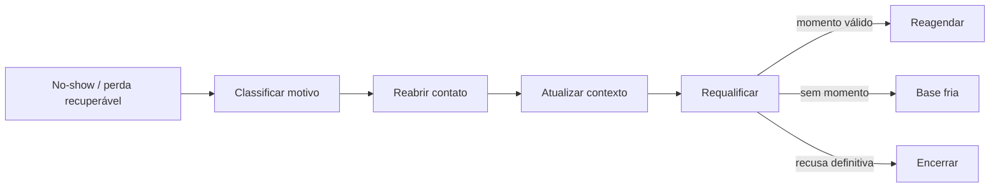

## 3.7 Cobrança e liberação 🟢

`PENDÊNCIA → NOTIFICAÇÃO → ACOMPANHAMENTO → CONCILIAÇÃO → LIBERAÇÃO`

> [!WARNING]
> Venda fechada não significa automaticamente cliente liberado. A fonte financeira confirma o pagamento; o handoff só avança depois disso.

## 3.8 Funil 🟠

`RASCUNHO → EM CONSTRUÇÃO → EM VALIDAÇÃO → EM PRODUÇÃO → ATIVO → PAUSADO → ENCERRADO`

| Gate | Verifica |
|---|---|
| Construção | promessa, público, oferta, jornada |
| Validação | páginas, integrações, tracking, experiência |
| Ativação | aquisição disponível + operação receptora pronta |
| Pausa | entrada interrompida sem perder histórico |
| Encerramento | dados, decisões e ativos preservados |

## 3.9 Automação 🟠

`ESPECIFICADA → EM DESENVOLVIMENTO → EM TESTE → ATIVA → MONITORADA → DESCONTINUADA`

**Contrato mínimo:** `trigger + condição + ação + idempotência + log + retry + rollback`.

## 3.10 Rotina 🟠

`DEFINIDA → AGENDADA → EM EXECUÇÃO → VERIFICADA → CONCLUÍDA`

**Exemplo:** revisão semanal de leads sem owner → checklist → correção → registro da ocorrência.

## 3.11 Ação pontual 🟠

`A FAZER → FAZENDO → EM VALIDAÇÃO → FEITA → ARQUIVADA`

> [!NOTE]
> Se crescer em escopo, dependência e duração, deixa de ser ação pontual e vira projeto ou demanda.

---

# 4. Produto & Cliente — definição e sustentação de valor

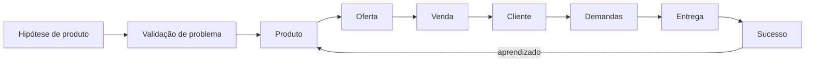

## 4.1 Produto 🟠

`HIPÓTESE → EM VALIDAÇÃO → EM DESENVOLVIMENTO → LANÇADO → ATIVO → EM EVOLUÇÃO → DESCONTINUADO`

| Stage | Pergunta | Evidência mínima |
|---|---|---|
| Hipótese | para quem e qual problema? | tese explícita |
| Validação | o problema e o valor existem? | sinais / entrevistas / uso |
| Desenvolvimento | como o valor será entregue? | escopo + sistema de entrega |
| Lançado | o público consegue acessar? | primeira entrega |
| Ativo | o produto opera com qualidade? | métricas + incidentes |
| Evolução | o que precisa melhorar? | backlog priorizado |
| Descontinuado | como preservar clientes e histórico? | plano de transição |

## 4.2 Oferta 🟠

`RASCUNHO → EM VALIDAÇÃO → ATIVA → PAUSADA → SUBSTITUÍDA`

**Componentes:** público · problema · promessa · mecanismo · composição · preço · prova · risco · termos.

## 4.3 Cliente 🟠

`ENTRADA → ONBOARDING → ATIVAÇÃO → EM ENTREGA → SUCESSO → RENOVAÇÃO → CHURN`

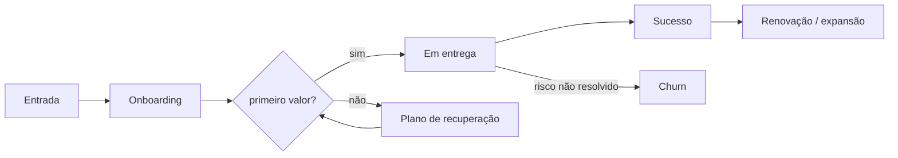

## 4.4 Demanda 🟠

`CAPTURADA → TRIADA → PRIORIZADA → EM EXECUÇÃO → EM VALIDAÇÃO → ENCERRADA`

| Classificação | Exemplo | Roteamento |
|---|---|---|
| Conteúdo | nova VSL | Produção |
| Receita | ajuste de funil | Receita |
| Produto | alteração de oferta | Produto & Cliente |
| Estratégica | novo canal/operação | Central |
| Incidente | integração quebrada | responsável técnico + prioridade |

---

# 5. Produção — composição, mídia e entrega

## 5.1 Modelo de objetos 🔵

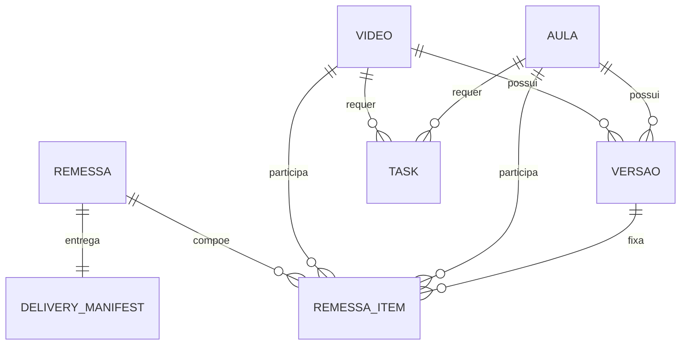

> [!IMPORTANT]
> A Remessa **compõe** objetos; não é proprietária deles. Cancelar uma Remessa não apaga Vídeos, Aulas, Versões nem evidências.

## 5.2 Remessa 🔵

`PLANEJADA → EM PRODUÇÃO → EM REVISÃO → PRONTA → ENTREGUE`

| Transição | Tasks | Gate | Output |
|---|---|---|---|
| Planejada → Em produção | delimitar itens · definir obrigatórios · atribuir owners | composição válida | plano da remessa |
| Em produção → Em revisão | acompanhar itens · relacionar versões | requeridos têm versão candidata | lote revisável |
| Em revisão → Pronta | revisar conteúdo · validar links · gerar preview | 100% requeridos aprovados | preview do manifesto |
| Pronta → Entregue | confirmar destino · despachar · registrar comprovante | confirmação humana | `delivery_manifest` imutável |

### Exemplo de composição

```yaml
remessa: REM-IBR-0042
status: EM_REVISAO
itens:
  - content: VIDEO-IBR-0091
    role: vsl_principal
    required: true
    version: VER-IBR-0091-V3
  - content: AULA-IBR-0018
    role: aula_modulo_1
    required: true
    version: VER-IBR-0018-V2
  - content: VIDEO-IBR-0098
    role: criativo_bonus
    required: false
    version: null
```

🔴 **Cancelamento:** concluídos permanecem concluídos; abertos viram `CANCELLED` ou `NOT_APPLICABLE`; acervo permanece reutilizável.

## 5.3 Vídeo / Aula 🔵

`A INICIAR → EM PRODUÇÃO → EM REVISÃO → APROVADO`

| Stage | Task típica | Evidência |
|---|---|---|
| A iniciar | conferir briefing e insumos | briefing válido |
| Em produção | roteirizar, gravar, editar | arquivo de trabalho |
| Em revisão | avaliar versão concreta | parecer + marcações |
| Aprovado | fixar versão vigente | aprovação registrada |

🔴 `EM REVISÃO → EM PRODUÇÃO` para retrabalho.
🔴 `CANCELADO` preserva versões já geradas.

## 5.4 Versão 🔵

`GERADA → EM ANÁLISE → APROVADA → SUPERSEDIDA`

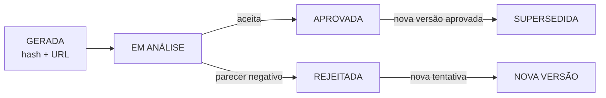

**Invariante:** tentativa nova cria outra `VERSAO`; nunca reabre nem sobrescreve a anterior.

## 5.5 Task de produção 🔵

`A FAZER → FAZENDO → FEITA`

| Campo | Exemplo |
|---|---|
| Verbo | ajustar áudio |
| Entidade | `VER-IBR-0091-V3` |
| Executor | editor-02 |
| Reviewer | qa-video-01 |
| Input | V2 + parecer técnico |
| Output | arquivo V3 + hash + URL |
| Acceptance criteria | volume dentro do padrão · sem clipping · sincronismo validado |
| Falhas | arquivo corrompido · insumo ausente · render incompleto |

🔴 `BLOQUEADA → informar impedimento → resolver → FAZENDO`
🔴 `CANCELADA → motivo + responsável + evidência`

---

# 6. Gates, checklists e evidências

## 6.1 Anatomia de um gate

```yaml
gate:
  entity: VIDEO-IBR-0091
  from_stage: EM_REVISAO
  to_stage: APROVADO
  required_tasks:
    - revisar_conteudo
    - revisar_audio
  acceptance_criteria:
    - versao_aprovada_existe
    - parecer_editorial_registrado
  blockers: []
  warnings:
    - thumbnail_pendente
  decision_owner: head-producao
  outcome: approved
```

| Resultado | Significado | Próxima ação |
|---|---|---|
| `approved` | passagem autorizada | avançar stage |
| `rejected` | output não aceito | corrigir ou encerrar |
| `blocked` | impedimento aberto | resolver blocker |
| `needs-information` | falta contexto | coletar informação |
| `cancelled` | transição abandonada | preservar histórico |

## 6.2 Evidência mínima por classe

| Classe | Exemplos |
|---|---|
| Fonte | briefing, contrato, gravação, mensagem, definição |
| Execução | log, checklist, timestamps, owner |
| Output | arquivo, relatório, versão, manifesto |
| Aceite | parecer, decisão, assinatura, status do gate |
| Continuidade | próximo consumidor, handoff, relação entre IDs |

---

# 7. Catálogo consolidado

| # | Board | Processo / entidade | Fonte | Início | Terminal normal |
|---:|---|---|---|---|---|
| 01 | Transversal | Full cycle comercial → entrega | 🟢 | aquisição | sucesso |
| 02 | Transversal | Ideia → operação estabilizada | 🟠 | captura | estabilização |
| 03 | Central | Decisão | 🟠 | aberta | revisada |
| 04 | Central | Iniciativa | 🟠 | capturada | encerrada |
| 05 | Central | Projeto transversal | 🟠 | proposto | concluído |
| 06 | Receita | Aquisição e captura | 🟢 | tráfego | fila SDR |
| 07 | Receita | SDR / qualificação | 🟢 | novo cadastro | agendado |
| 08 | Receita | Reunião estratégica | 🟢 | agendada | ganho |
| 09 | Receita | Closer / venda | 🟢 | preparação | handoff |
| 10 | Receita | Recuperação SDR4 | 🟢 | exceção recuperável | reagendado |
| 11 | Receita | Cobrança | 🟢 | pendência | liberação |
| 12 | Receita | Funil | 🟠 | rascunho | encerrado |
| 13 | Receita | Automação | 🟠 | especificada | descontinuada |
| 14 | Receita | Rotina | 🟠 | definida | concluída |
| 15 | Receita | Ação pontual | 🟠 | a fazer | arquivada |
| 16 | Produto & Cliente | Produto | 🟠 | hipótese | descontinuado |
| 17 | Produto & Cliente | Oferta | 🟠 | rascunho | substituída |
| 18 | Produto & Cliente | Cliente | 🟠 | entrada | renovação / churn |
| 19 | Produto & Cliente | Demanda | 🟠 | capturada | encerrada |
| 20 | Produção | Remessa | 🔵 | planejada | entregue |
| 21 | Produção | Vídeo / Aula | 🔵 | a iniciar | aprovado |
| 22 | Produção | Versão | 🔵 | gerada | supersedida / rejeitada |
| 23 | Produção | Task | 🔵 | a fazer | feita |

---

# 8. Pontos ainda sujeitos a validação

- [ ] Confirmar os lifecycles candidatos de Central, Receita e Produto & Cliente.
- [ ] Definir owners e reviewers por operação.
- [ ] Relacionar cada view do Monday ao lifecycle que ela deve revelar.
- [ ] Definir SLAs somente depois de medir a primeira semana.
- [ ] Substituir exemplos pelos primeiros objetos reais populados.
- [ ] Revisar retrabalhos, bloqueios e atalhos após 1–2 semanas de piloto.

> [!CAUTION]
> **Não promover candidato como regra operacional por plausibilidade.** O Full Sales observado e a Produção ratificada estão separados dos modelos TO-BE candidatos.

---

## Próximo gate

**Owner escolhe quais fluxos entram na primeira carga de 60–70% e quem valida cada conjunto.**
